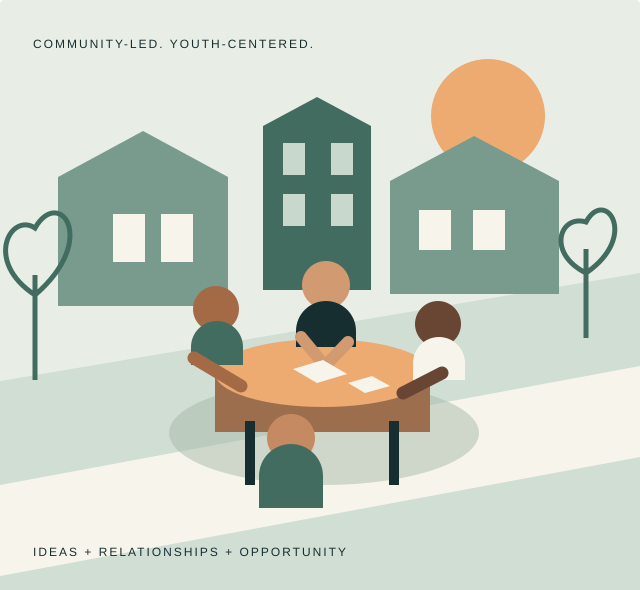

::: {.hero}

::: {.feature-content}

::: {.eyebrow}

Rooted in community. Built around young people.

:::

# Young people. Stronger communities. More opportunity.

::: {.intro}



Teen Service Project connects a simple idea—young people can help shape their communities—with a larger question: what would it take for every young person to have that opportunity?

:::

::: {.actions}

[Explore the program](programs/index.qmd){.btn-tsp}
[Our research & policy priorities →](research/index.qmd){.text-link}

:::

:::

::: {.feature-content}

::: {.illustration-credit}

An idea for what communities can build together.

:::

:::

:::

::: {.mission-strip}

<b>01</b> Community programming
<b>02</b> Applied research
<b>03</b> Public policy advocacy

:::

::: {.section-heading}

::: {.eyebrow}

One mission. Three connected ways forward.

:::

## Opportunity starts locally. Change reaches further.

Practical service experiences can raise important questions about access, support, and public investment. Research can help answer those questions. Advocacy can turn what we learn into better opportunities.

:::

::: {.three-grid}

::: {.feature}

::: {.number}

01 / PARTICIPATE

:::

### Young people lead.

Our developing event model brings teenagers and neighbors together to shape youth-led service ideas and connect them with community support.

[How the model works →](programs/index.qmd)

:::

::: {.feature}

::: {.number}

02 / UNDERSTAND

:::

### Evidence informs action.

Our research agenda asks who gets to participate in service, what support matters, and how programs can expand educational, civic, and workforce opportunity.

[Explore the research agenda →](research/national-service.qmd)

:::

::: {.feature}

::: {.number}

03 / ADVOCATE

:::

### Access is a policy choice.

Our initial policy priority is expanding voluntary, paid national service in the United States, with attention to compensation, inclusion, and program quality.

[Read our policy approach →](research/index.qmd#policy-approach)

:::

:::

::: {.research-feature}

::: {.feature-content}

::: {.eyebrow}

First research priority / In development

:::

## Making national service an opportunity more young people can choose.

We are establishing a transparent research workspace on paid national service, starting with questions about access, workforce development, civic participation, and public investment.

[Read the national service research agenda →](research/publications/2026-national-service-agenda/index.qmd)

:::

::: {.research-question}

What would meaningful service look like if the ability to participate did not depend on the ability to go unpaid?

:::

:::

::: {.section-heading}

::: {.eyebrow}

A practical model, open to local adaptation

:::

## A gathering. An idea. A community behind it.

Teenagers identify local strengths, develop service proposals, and share their ideas with neighbors. Support can mean time, knowledge, space, connections, or small grants when available. An expensive venue or a fundraising target is not a prerequisite.

[For teens](programs/teens.qmd) · [For facilitators](programs/facilitators.qmd) · [For host communities](programs/hosting.qmd)

:::

## From TSP

Development notes and updates as this foundation takes shape.

::: {#latest}

:::

::: {.note}

**Help shape what comes next.** TSP is redeveloping an existing initiative. Programming resources and research are in development; events and participation opportunities will be announced when confirmed. [See ways to contribute](get-involved.qmd).

:::

